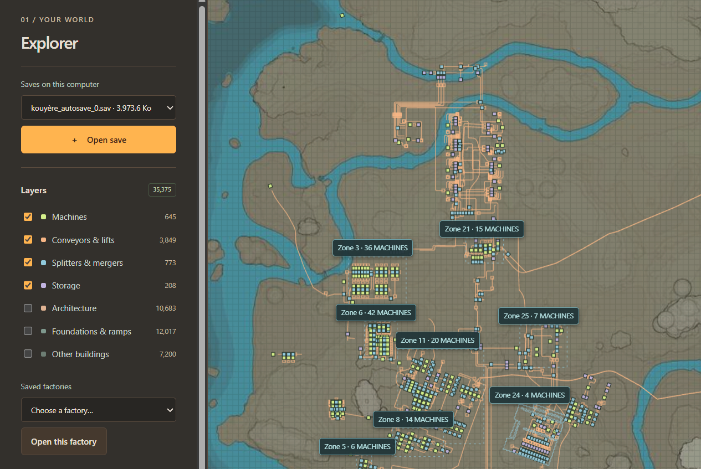
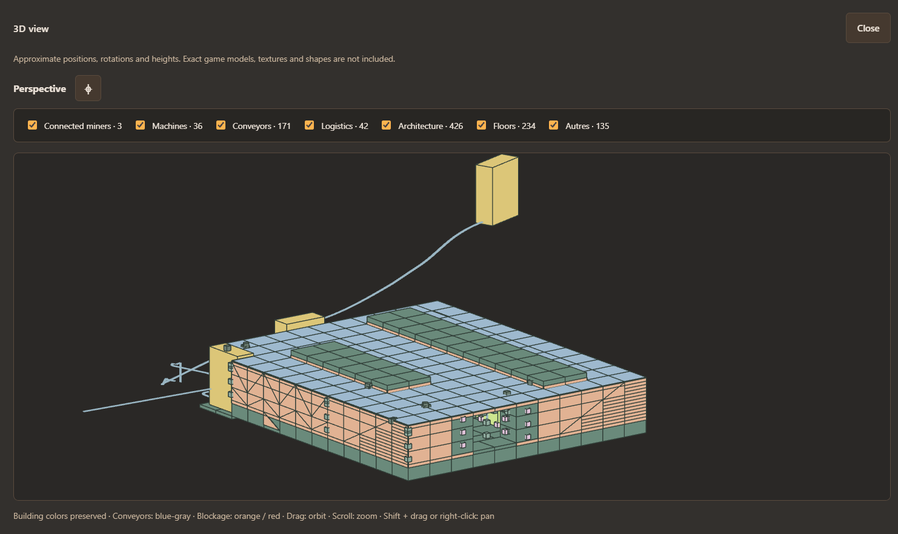
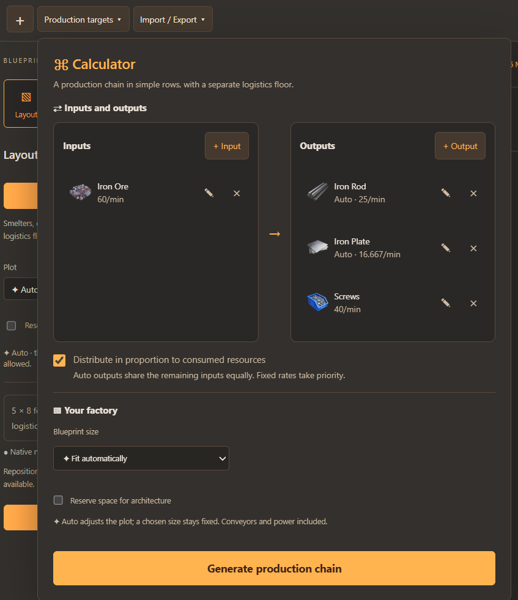
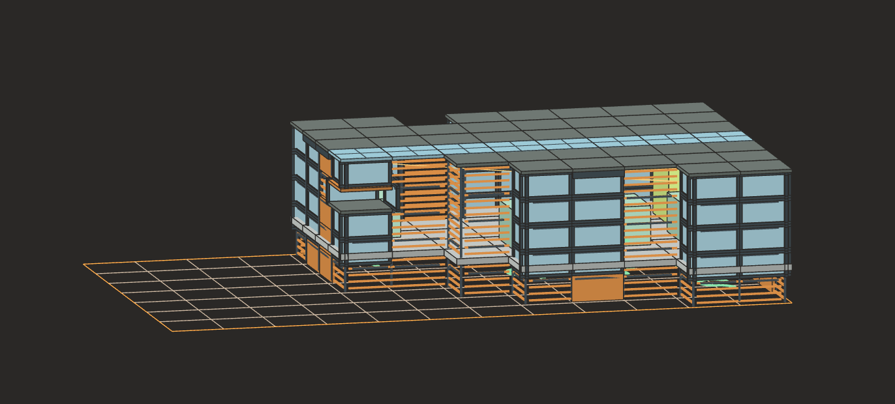
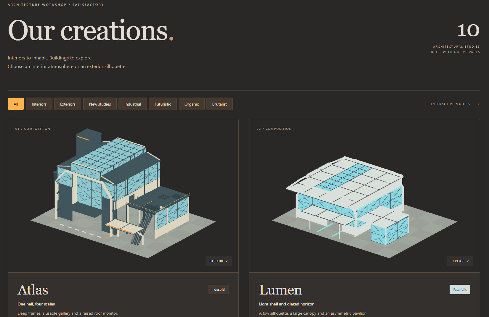

# Factory Manager


An open-source local tool for exploring Satisfactory saves, planning factories, and designing their architecture. Built with Python and browser JavaScript.

**Work in progress. Development is moving slowly for now.** Two workstreams are underway and need further development. Contributions to either are welcome.

## Features

### Explore your map

Open a Satisfactory save, view your world, filter buildings and networks, and find your factories.



### Visualize factories in 3D

Preview a factory from a manual map selection or a detected factory area. Toggle layers to inspect machines, conveyors, logistics, and architecture.



### Calculate and generate production

Set inputs and target outputs, balance production rates, and generate simple machine rows. A separate 4 m logistics floor is optional.



### Design your workshop

Work on the layout, then switch to Design to explore procedural facades, materials, glazing, and lighting around your factory.



### Architecture and Creations

Use the **Creations** architecture section for more detailed building designs. These templates are less scalable and procedural than the general design generator, and still need refinement. They are also accessible from the workshop's **Design** view to dress your factory.



Export workshop projects as JSON and supported designs as native blueprints. Everything runs locally; original saves are read without being modified.

## Work to continue

### 1. Factory layout optimization

Improve machine placement, compact layouts, conveyor routing, and connections between production stages. The goal is to generate practical, connected factories under production and space constraints. Current generation is experimental and is not a complete factory optimizer.

### 2. Decoration and architecture

Develop procedural decoration and refine the **Creations** templates: silhouettes, materials, glazing, lighting, and how buildings expand. Both approaches need more work on visual quality, integration with production layouts, and in-game validation.

## Run locally

Requires Python 3.10+ and a modern browser. No pip or npm install is needed to run the app. Node.js is used for JavaScript tests only.

```sh
python server.py --open
```

Open [localhost:8765](http://127.0.0.1:8765). Stop the server with `Ctrl+C`. Use `--port 8766` if the default port is busy.

On Windows, you can also use `external-tool/Ouvrir Factory Manager.cmd` if Python is installed in a location supported by the launcher. The interface supports English and French; use the language selector in the top-right corner.

## Current limits

Previews use simplified geometry, not the game's models. Native exports, collisions, materials, and lighting still need in-game checks. Some machines, recipes, networks, and modded saves are not supported. Save imports are limited to 64 MB.

## Project structure

- `external-tool/` — the current app, generators, and tests.
- `documentation/` — implementation notes and known limitations, mostly in French.
- `starter-project/` — attribution and upstream link for an earlier Unreal starter; its full checkout is not included.

## License and credits

Original Factory Manager code is available under the [MIT License](../LICENSE-MIT): reuse, modify, and distribute it, including commercially, while keeping the license notice.

The bundled application uses the GPL-3.0 save parser **sat_sav_parse**, so distribution of the combined application must still comply with GPL version 3. Third-party code and game/community assets retain their own terms. See [Licensing](../LICENSING.md) for the scope.

Thanks to [GreyHak/sat_sav_parse](https://github.com/GreyHak/sat_sav_parse), [greeny/SatisfactoryTools](https://github.com/greeny/SatisfactoryTools), and [SatisfactoryModLoader](https://github.com/satisfactorymodding/SatisfactoryModLoader), as well as JazzFrank, the Satisfactory Wiki community, and Coffee Stain Studios. See [Credits and third-party notices](../CREDITS.md) for their roles, sources, and licenses.
